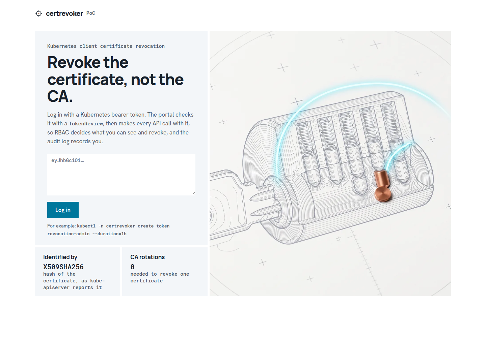
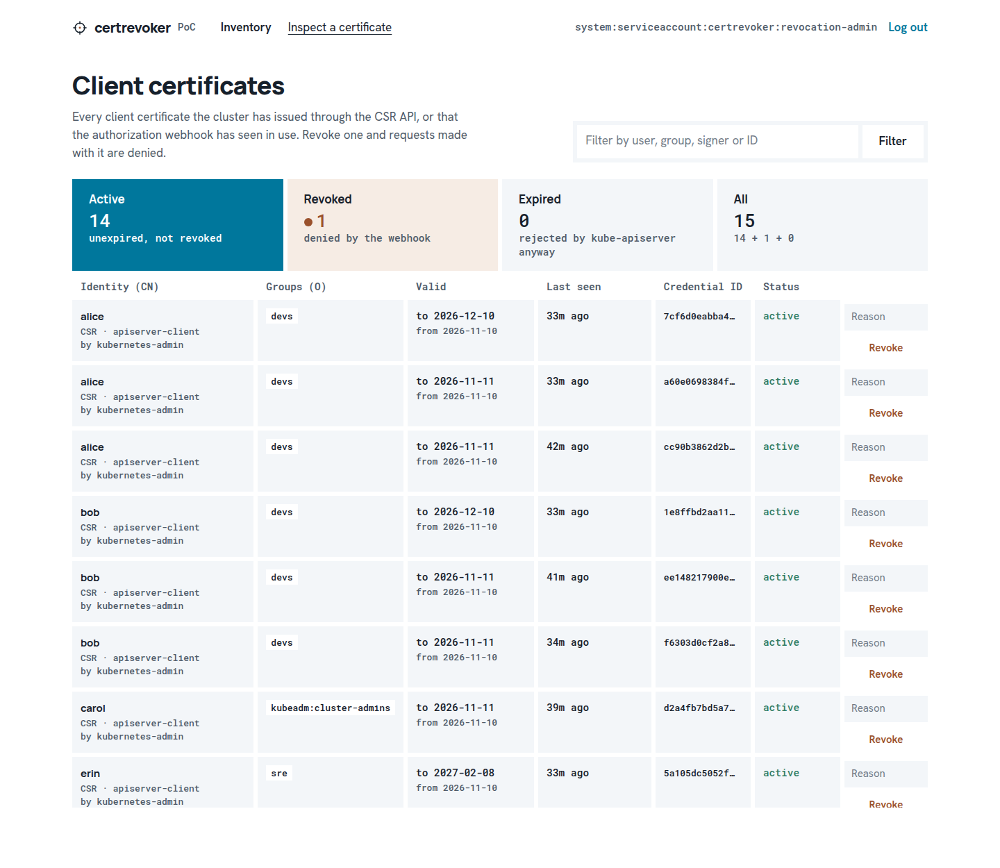
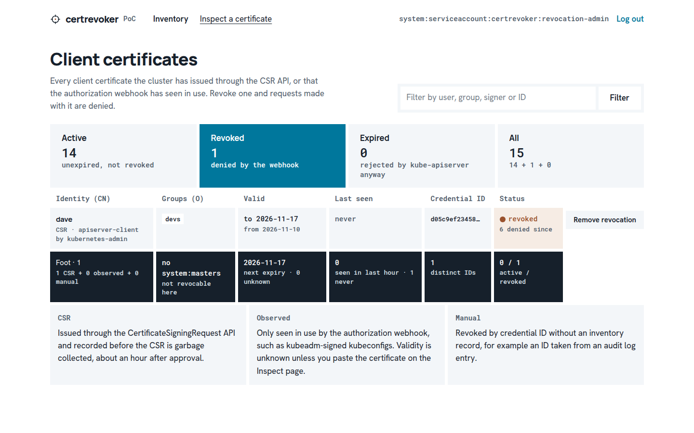
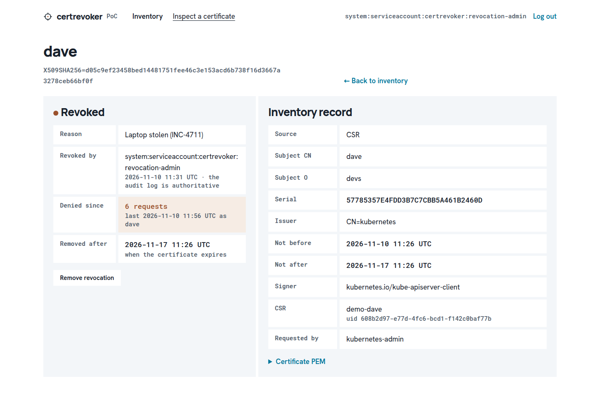
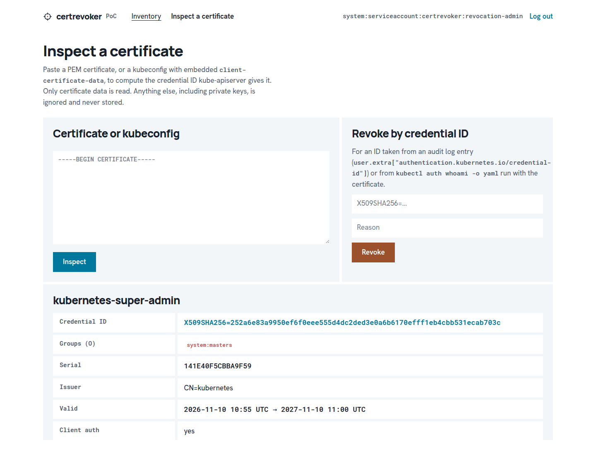

# certrevoker

**Revoke a Kubernetes client certificate without rotating the CA.**

certrevoker is a proof of concept: an authorization webhook, an inventory of issued client certificates, and a small web portal. Together they let a cluster administrator block a specific x509 client certificate within seconds.

Website: <https://raesene.github.io/certrevoker/>

> **Status: proof of concept.** It works and has been tested end to end on kubeadm 1.37, but it hasn't been hardened for production. Read [What it does not do](#what-it-does-not-do) before relying on it.

---

## The problem

Kubernetes has supported x509 client certificates for authentication from the start. It has never supported revoking them. [kubernetes/kubernetes#18982](https://github.com/kubernetes/kubernetes/issues/18982), "Support for managing revoked certs", has been open since December 2015.

- **No CRL or OCSP check.** kube-apiserver checks that a client certificate chains to a CA in `--client-ca-file` and hasn't expired. Nothing else.
- **Deleting the CSR does nothing.** The certificate keeps working until its `notAfter`, which defaults to a year for kubeadm-generated and CSR-issued certificates.
- **Removing RBAC bindings isn't enough.** The user still gets everything granted to `system:authenticated`. Certificates in `system:masters` skip authorization entirely.
- **The only built-in remedy is rotating the cluster CA.** That means reissuing every certificate signed by it, including the kubelets' and the control plane's own.

So a lost laptop or a leaked kubeconfig means either living with a valid credential until it expires, or a disruptive CA rotation.

Upstream, SIG Auth's [KEP-6285](https://github.com/kubernetes/enhancements/issues/6285) (structured x509 authentication configuration, with CEL validation rules) is the most likely long-term answer, but it is still provisional. certrevoker shows what can be done **today, with no changes to Kubernetes**.

## What certrevoker does

```
client cert ──▶ kube-apiserver: x509 authentication → authorizers:
                 system:masters ─▶ [certrevoker webhook] ─▶ Node ─▶ RBAC
                                          │ SubjectAccessReview (extra: credential-id)
kubelets / aggregated APIs ── SAR ────────┤
                                          ▼
   certrevoker (one pod, host network, on the control plane)
     ├─ webhook    127.0.0.1:9443  Deny if revoked, otherwise NoOpinion (mTLS from kube-apiserver)
     ├─ inventory  CSR informer → IssuedCertificate (Source=CSR)
     ├─ observer   credential IDs seen by the webhook → IssuedCertificate (Source=Observed)
     ├─ gc         removes revocations and records once the certificate has expired
     └─ portal     :8443  Kubernetes-token login; reads and writes with the admin's own token
   state: cluster-scoped CRDs IssuedCertificate and CertificateRevocation
```

1. **It blocks revoked certificates.** Since v1.32, kube-apiserver records every client certificate's identity as `authentication.kubernetes.io/credential-id: X509SHA256=<sha256 of the certificate>`. certrevoker's authorization webhook runs before Node and RBAC. It returns an explicit **Deny** for any request carrying a revoked credential ID, and no opinion otherwise.
2. **It covers kubelets and aggregated API servers too.** They authorize through SubjectAccessReviews, which carry the credential ID and reach the same webhook.
3. **It keeps an inventory of issued certificates.** Kubernetes keeps no record of the certificates it issues: approved CSRs are deleted about an hour after issue. certrevoker copies every client certificate issued through the CSR API into an `IssuedCertificate` object. It also records each credential ID the webhook sees in use, which catches certificates signed outside the CSR API, such as kubeadm's `admin.conf`.
4. **It provides a portal for administrators.** Log in with a Kubernetes token, browse unexpired certificates, and revoke or un-revoke one with a reason. You can also paste a certificate or kubeconfig to compute its credential ID. Revocations are ordinary Kubernetes objects, so `kubectl` works too.

## What it does not do

- **It can't revoke `system:masters`.** kube-apiserver allows that group before any authorizer runs, both for direct requests and for SubjectAccessReviews. kubeadm's `super-admin.conf` is such a certificate. The portal flags these as "not enforceable". (CSRs asking for `system:masters` on the `kube-apiserver-client` signer are rejected by the default-on `CertificateSubjectRestriction` admission plugin. Other powerful groups, such as `kubeadm:cluster-admins`, are not restricted, but those certificates *can* be revoked by certrevoker.)
- **It isn't instant everywhere.**
  - kube-apiserver applies a revocation within the webhook's `unauthorizedTTL`, 10s as configured here.
  - Requests made **directly to a kubelet** can keep working for up to the kubelet's `authorization.webhook.cacheAuthorizedTTL`, 5 minutes by default.
  - Requests already in progress (watch, exec, port-forward) aren't interrupted.
- **It fails open.** In kubeadm clusters the kubelets, controller-manager and scheduler all use client certificates, so the webhook uses `failurePolicy: NoOpinion` to avoid taking the cluster down if certrevoker is unavailable. While it's down, revoked certificates work.
- **It doesn't see everything.** Certificates signed outside the CSR API appear only once they're used, and without validity dates unless you paste the certificate on the Inspect page. CSR-issued certificates are only recorded if certrevoker was running within an hour of issue (before the CSR was garbage collected), or once they're used.
- **It doesn't defend against a compromised CA key.** Anyone holding the key can mint new certificates. Only CA rotation helps then.
- **It isn't hardened.**
  - It runs as a single replica on a single control-plane node.
  - TLS material comes from a script.
  - Portal sessions are held in memory, and login isn't rate-limited.
  - certrevoker's own service account can delete revocations, which it needs for garbage collection, so a compromised certrevoker pod could remove them.

## Requirements

- A kubeadm-style cluster on **Kubernetes 1.32 or later**. The x509 credential ID and structured authorization configuration (`--authorization-config`) are both available from 1.32. Tested on 1.37.2.
- Root access to the control-plane node(s), to edit the kube-apiserver static pod manifest. Managed Kubernetes services don't allow this.
- To build: Go 1.26+, Docker, `openssl`.

## Deploy

```bash
# 1. Build the image and load it onto the control-plane node
CGO_ENABLED=0 go build -trimpath -ldflags "-s -w" -o bin/certrevoker ./cmd/certrevoker
docker build -t docker.io/library/certrevoker:dev .
docker save docker.io/library/certrevoker:dev -o bin/certrevoker-image.tar
#   copy the tar to the control-plane node, then on that node:
#   ctr -n k8s.io images import certrevoker-image.tar

# 2. Generate TLS material: a private CA, webhook and portal serving certs,
#    the client cert kube-apiserver presents to the webhook, the webhook
#    kubeconfig, and a Secret for the Deployment
./scripts/gen-certs.sh tls <control-plane-ip>

# 3. Install the CRDs, RBAC and Deployment (before changing kube-apiserver)
kubectl apply -f deploy/crds.yaml -f deploy/rbac.yaml
kubectl apply -f tls/secret.yaml -f deploy/deployment.yaml
kubectl -n certrevoker rollout status deploy/certrevoker
```

**4. Point kube-apiserver at the webhook.** On each control-plane node:

```bash
install -d -m 0700 /etc/kubernetes/certrevoker
install -m 0600 deploy/authz-config.yaml tls/authz-webhook.kubeconfig /etc/kubernetes/certrevoker/
```

Edit `/etc/kubernetes/manifests/kube-apiserver.yaml`. Copy it out, edit the copy, then copy it back, so the kubelet never reads a half-written file. Make three changes:

- Replace `--authorization-mode=Node,RBAC` with `--authorization-config=/etc/kubernetes/certrevoker/authz-config.yaml`. The config keeps Node and RBAC, after the webhook.
- Add a read-only `hostPath` volume and mount for `/etc/kubernetes/certrevoker`.
- Keep a backup of the original manifest. To roll back, restore it.

[`deploy/authz-config.yaml`](deploy/authz-config.yaml) explains each webhook setting: `matchConditions` so only certificate-authenticated requests reach the webhook, `failurePolicy`, and the cache TTLs that bound how long a revocation takes to apply.

## Use

**Portal.** Open `https://<control-plane-ip>:8443` (its CA is `tls/ca.crt`) and log in with a token for an identity bound to the `certrevoker-admin` ClusterRole. The manifests include a demo one:

```bash
kubectl -n certrevoker create token revocation-admin --duration=1h
```

From a workstation without direct access: `ssh -L 8443:<control-plane-ip>:8443 <jump-host>`, then open `https://localhost:8443`.

**Finding a certificate's credential ID.** If the certificate is in the inventory, the portal shows it. Otherwise:

```bash
# from the certificate file
echo "X509SHA256=$(openssl x509 -in cert.pem -outform DER | sha256sum | cut -d' ' -f1)"
# from a kubeconfig that uses it
kubectl --kubeconfig user.kubeconfig auth whoami -o jsonpath='{.status.userInfo.extra.authentication\.kubernetes\.io/credential-id[0]}'
```

It also appears in kube-apiserver audit events, under `user.extra["authentication.kubernetes.io/credential-id"]`, for every request the certificate made.

**Revoking with kubectl.** The object name must be `sha256-` followed by the hex digest; the CRD validates this.

```yaml
apiVersion: certrevoker.example.com/v1alpha1
kind: CertificateRevocation
metadata:
  name: sha256-<hex>
spec:
  credentialID: X509SHA256=<hex>
  reason: Laptop stolen (INC-4711)
```

```bash
kubectl get issuedcertificates          # the inventory
kubectl get certificaterevocations      # what is revoked, with denied-request counts
kubectl delete certificaterevocation sha256-<hex>   # un-revoke
```

## Design choices

| Choice | Why |
|---|---|
| **Explicit Deny, before Node and RBAC** | Node and RBAC can only allow, and the first allow wins. An explicit Deny stops the chain, so grants to `system:authenticated` don't apply to a revoked certificate either. |
| **`matchConditions`: x509 requests only** | Token-authenticated traffic, including certrevoker's own, never reaches the webhook. |
| **`failurePolicy: NoOpinion`** | A webhook outage must not break kubelets and controllers that authenticate with certificates. |
| **Webhook served only after caches sync** | It never answers "not revoked" from an empty cache. Until then kube-apiserver gets connection errors and applies the failure policy. |
| **CRDs, one object per credential** | `sha256-<hex>` names (enforced by CEL validation) make lookups O(1) from an informer cache. Revoking goes through the API, so it gets RBAC, an audit trail, and multi-replica safety. Revocations are immutable. |
| **Portal acts as the logged-in admin** | Tokens are validated with `TokenReview`, then used for every API call, so kube-apiserver enforces RBAC and the audit log records the real person. The browser holds only an opaque, HttpOnly, SameSite=Strict session cookie. Every POST requires a CSRF token, and the CSP is `default-src 'self'`. |
| **Revocations retire themselves** | Each stores the certificate's `notAfter` and is garbage-collected once the certificate expires, so the list stays small. |

## Tests

- **Unit tests:** `go test ./...` covers the credential-ID calculation (which must match kube-apiserver's), webhook decisions, and portal login, revoke, unrevoke and CSRF, using fake clients. They run in CI.
- **End-to-end:** [`scripts/e2e.sh`](scripts/e2e.sh) runs 26 checks against a live cluster.

### End-to-end results (kubeadm 1.37.2: 26/26 passed)

| Scenario | Result |
|---|---|
| CSR for `O=system:masters` (kube-apiserver-client signer) | Rejected by `CertificateSubjectRestriction` |
| CSR for `O=kubeadm:cluster-admins` | Issued: gives cluster-admin through kubeadm's RBAC binding |
| Credential ID computed by certrevoker vs `kubectl auth whoami` | Identical |
| CSR-issued certificate appears in the inventory | Within 1s |
| Certificates signed outside the CSR API (Observed) | kubeadm `admin.conf`, controller-manager, scheduler, control-plane kubelet |
| Revoke in the portal, then a request to kube-apiserver | Denied after **10s**: `client certificate X509SHA256=… has been revoked: <reason>` |
| Revoked user's `SelfSubjectReview` | Denied |
| Other users | Unaffected |
| Revoked user going directly to a kubelet (`:10250/pods`) | Denied after **290s** (kubelet authorization cache, 5m default) |
| cluster-admin through an RBAC group, revoked | Denied immediately |
| kubeadm `super-admin.conf` (`system:masters`) revoked | **No effect**, as expected; never reaches the webhook |
| Webhook scaled to zero | Revoked certificate works again (fail-open); denied again once it's back |
| Denied-request counter | Recorded on the revocation and shown in the portal |
| Unrevoke | Access restored |

## Portal design

The portal uses the [Reticle Ledger](https://katagami.ai/language/en-01a1016d-85de-78d0-8a51-df79bee46564) design language from Katagami:

- **Cells, not lines:** flat cells parted by 6px of white, with no borders or shadows.
- **Cyan** for the live or selected item.
- **Copper** only for revocations, a decision a person signed.
- **Foot row:** every column has an ink total that says how it was reached.

Fonts (Manrope, Hanken Grotesk, Roboto Mono; SIL Open Font License 1.1) are embedded in the binary, so the portal makes no third-party requests. The hero image was generated in the design's paired art style, [Calibration Plate](https://katagami.ai/art-styles/en-019ef95b-aa08-73d2-b1f5-7c9d97799052). The [website](https://raesene.github.io/certrevoker/) uses the same design.

| | |
|---|---|
| Login |  |
| Inventory |  |
| Revoked view |  |
| A revoked certificate |  |
| Inspect: `super-admin.conf` flagged as not enforceable |  |

## Repository layout

```
cmd/certrevoker/        main: wires the webhook, inventory, observer, GC and portal together
internal/certid/        credential-ID calculation and certificate parsing
internal/webhook/       the SubjectAccessReview handler
internal/inventory/     CSR inventory controller, usage observer, garbage collector
internal/state/         informer-backed caches of the custom resources
internal/resources/     CRD types
internal/portal/        web portal (templates, CSS, fonts, hero image embedded)
deploy/                 CRDs, RBAC, Deployment, kube-apiserver authorization config
scripts/                TLS generation and the end-to-end test
site/                   the project website (GitHub Pages)
```

## Website

The site lives in [`site/`](site/). `site/build.sh` assembles it into `_site/` with the portal's fonts, hero image and screenshots. The [Pages workflow](.github/workflows/pages.yml) builds and deploys it on every push to `main` that touches the site or its assets. To preview locally:

```bash
./site/build.sh && python3 -m http.server -d _site 8000
```
